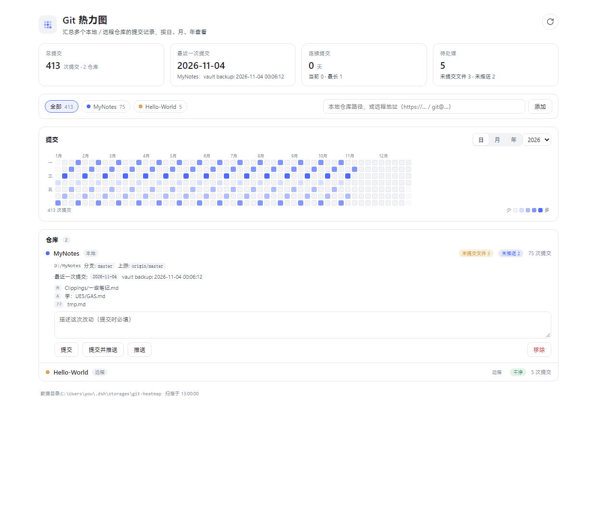
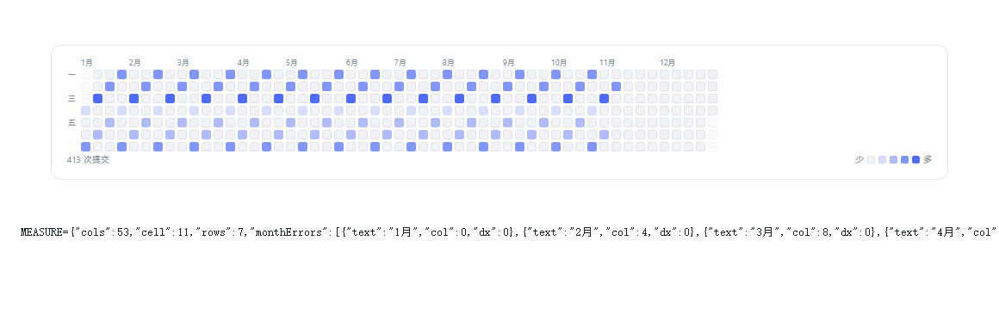

# dsh-git-heatmap · Git 热力图

把**多个本地 / 远程 Git 仓库**的提交记录汇总成一张 GitHub 风格的贡献热力图，按**日 / 月 / 年**查看；
点一下刷新就去检测选中的仓库有没有新提交；有未提交改动或未推送提交的仓库，可以直接在面板里提交、推送。

面向同时维护多个仓库的开发者（比如一个 UE 工程 + 一个算法练习库 + 一个笔记库）：不用再为了确认
"今天到底提交了没"反复切终端，也不用被"GitHub 贡献图只能看单个仓库"限制。



## 功能

- **多仓库聚合**：所有仓库逐日提交数相加；也可以点顶部胶囊只看某一个仓库。
- **日 / 月 / 年三种粒度**：日视图是 7×N 周历（可切年份），月视图按年 × 12 个月，年视图一年一格。
- **刷新**：只对远程条目 `git fetch`（没有克隆就先 `clone --bare --filter=blob:none`）；**本地仓库不 fetch**，只重扫已有历史。
- **统计小卡**：总提交、最近一次提交（仓库 + 日期 + 标题）、当前 / 最长连续提交天数、未提交文件数与未推送提交数。
- **面板内提交 / 推送**：展开仓库行即可操作。`提交` = `git add -A` + `git commit -m`；`提交并推送` 再加 `git push`（无上游时 `push -u origin HEAD`）。**永远不带 `--force`**，远程条目是只读裸库、不能提交。
- **远程仓库不需要 token**：走 bare 克隆（不存文件内容），GitHub / Gitee / 自建 GitLab / ssh 地址通用。



## 安装

```bash
# npm 发布后
dsh plugin --profile <profile> add dsh-git-heatmap

# 从 GitHub 源码
dsh plugin --profile <profile> add github:<user>/dsh-git-heatmap

# 本地打好的 tgz
dsh plugin --profile <profile> add <路径>/dsh-git-heatmap-0.1.0.tgz
```

Desktop 版：在 **插件** 页搜索包名安装，或按上面的 `dsh plugin` 命令装进 Desktop 使用的 profile
（注意 Desktop 用的是它自己的 profile，不是 `web`）。

## 使用

1. 左侧栏点「Git 热力图」。
2. 输入框填**本地仓库绝对路径**（如 `D:\code\my-project`）或**远程地址**（`https://…` / `git@…`），回车添加。
3. 点右上角圆形箭头刷新。
4. 点仓库行展开，填提交信息后可提交 / 推送；点 `移除` 把仓库从列表删掉（远程条目会连带删掉裸克隆缓存）。

## 兼容性

| DSH | 平台 | 状态 |
| --- | --- | --- |
| 0.2.1-rc.5 | Windows 11 · git 2.56 | ✅ 实测通过（功能、边界、对齐、只读性） |
| 其它 0.2.x | — | 未实测；客户端槽位与模块运行时契约相同，理论上可用 |
| 0.1.x | — | ❌ 不支持（客户端半侧用的是 0.2 形态的槽位与 `__ModuleLoader__` 运行时） |
| macOS / Linux | — | 未实测；宿主半侧无 Windows 硬依赖（git 走 PATH、目录用 `DSH_HOME`/`~/.dsh`、命令全走 `execFile` 数组） |

**故意没有写 `engines.dsh` 硬闸门。** 原因是 semver 的预发布语义：`semver.satisfies('0.2.2-alpha.2', '>=0.2.1-rc.2 <0.3.0') === false`——写死范围会把 nightly 用户挡在门外。
所以这里用 `dsh.compatibility.dshReleases` 声明**实测过**的版本（目前只有 `0.2.1-rc.5`），是否安装交由用户判断。

## 它会不会动你的仓库？

- **扫描是只读的**：`git log` / `rev-list` / `symbolic-ref` / `rev-parse` / `remote` 都不写盘；唯一有副作用风险的 `git status` 用了 `git --no-optional-locks status --porcelain`，实测扫描前后 `.git/index` 的大小与 mtime 完全不变。
- **刷新只 fetch 远程条目**：不往你自己的仓库里拉对象、不动 `refs/remotes`。本地仓库要看到远端新提交，自己在终端 fetch 一次再点刷新即可。
- **写操作只有两个按钮**：提交、推送；没有后台写入、没有定时任务、没有遥测。
- **数据目录**：`%USERPROFILE%\.dsh\storages\git-heatmap\`
  - `config.json`：仓库清单（几 KB）
  - `repos/<id>/`：仅远程条目的裸克隆（`--filter=blob:none`，不存文件内容），移除仓库时删除
  - 环境变量 `DSH_GIT_HEATMAP_DIR` 可整体改位置

## 已知限制

- 本地仓库的「落后（behind）」数只反映你上次 fetch 的状态（因为插件不替你 fetch）。
- 私有仓库依赖系统的 credential helper / ssh agent：插件设了 `GIT_TERMINAL_PROMPT=0` + `GIT_ASKPASS=echo`，**不会弹凭据框**，取不到凭据就报「克隆失败：Authentication failed」。
- 超大仓库：首次克隆与 `git log --all` 会明显变慢，克隆期间没有进度条。
- 局域网 / 反向代理访问：路由有三道信任检查（回环、本机绑定地址、`trustedHosts`），用域名或反代 Host 打开会 403，需要把该 Host 加进 `--trusted-host`。

## 接口

宿主半侧注册 `/git-heat/api` 前缀路由，浏览器半侧用文档相对路径访问：

| 接口 | 作用 |
| --- | --- |
| `POST /git-heat/api/state` | 扫描结果（15s 内存缓存，不落盘） |
| `POST /git-heat/api/add` | `{ input }` 添加本地路径或远程地址 |
| `POST /git-heat/api/remove` | `{ id }` 移除（远程裸克隆一并删除） |
| `POST /git-heat/api/refresh` | 只 fetch/克隆远程条目，然后强制重扫全部仓库 |
| `POST /git-heat/api/commit` | `{ id, message, push }` 提交 / 推送 |

请求带与官方 `/api` 网关同样的三道检查：Host 必须是回环 / 本机绑定地址 / `trustedHosts`、
拒绝 `sec-fetch-site: cross-site`、Origin 必须与 Host 同源。

## 开发

纯 JS，无构建步骤。`test/` 下有本地验证脚本（不随包发布）：

| 脚本 | 作用 |
| --- | --- |
| `smoke-host.mjs` | 假 ctx + 本地 http 服务跑宿主半侧：state / add / remove / 坏路径 / 信任栅栏 |
| `smoke-client.mjs` | 用迷你渲染器把日 / 月 / 年热力图、仓库行、面板跑一遍 |
| `edge-paths.mjs` | 带空格与中文的路径、空仓库 |
| `readonly-check.mjs` | 验证扫描不改动 `.git/index` |
| `refresh-semantics.mjs` | 验证刷新不 fetch 本地仓库、`/state` 15s 缓存 |
| `make-preview.mjs` | 用真实 CSS + 真实组件输出生成 `docs/` 截图 |

## License

MIT
